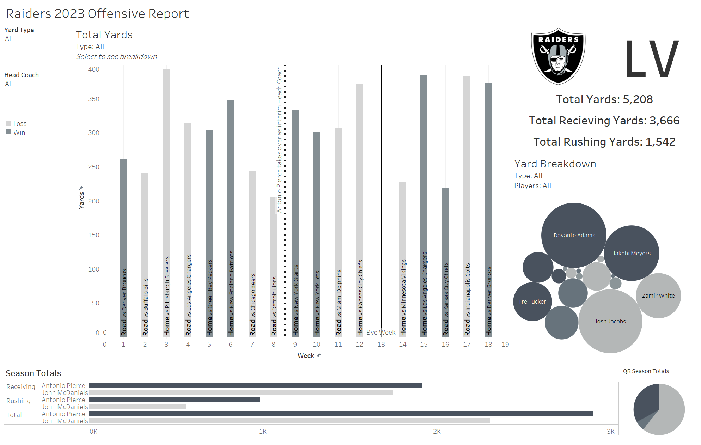

# Tableau Sports Dashboards

A collection of Tableau dashboards covering the NFL, NBA and MLB, plus one personal health-data dashboard. Each workbook is a packaged `.twbx` file that includes its data, so it opens directly in Tableau Desktop or Tableau Public.

## Gallery

### Raiders 2023 Offensive Report
Workbook: [`workbooks/RaidersOffensiveReview.twbx`](workbooks/RaidersOffensiveReview.twbx) · Write-up: [Executive Summary (PDF)](docs/Raiders%202023%20Dashboard%20Executive%20Summary.pdf)

A review of the Las Vegas Raiders' 2023 offense, built as a guide for the incoming coaching staff. It shows weekly total yards colored by win or loss, a bubble chart of yards by player, and season totals split by head coach (Josh McDaniels vs. interim coach Antonio Pierce, who took over after Week 8). Filters for yard type and head coach update the main charts, and selecting a week shows that game's player breakdown. Season totals: 5,208 total yards, 3,666 receiving and 1,542 rushing. The team finished 8-9, second in the division, and missed the playoffs.

### Seattle Draftboard
Image: [`images/Seattle Dashboard.png`](images/Seattle%20Dashboard.png)

A draft board for building a hypothetical Seattle NBA roster. The player pool is active players from the prior season who have won no NBA award (All-Star, All-NBA, All-Rookie, All-Defensive) and have three or fewer years in the league. It shows per-48-minute leaders in points, rebounds and assists, the stats of the selected roster, and the roster's expected game stats with each player at 24 minutes. The selected roster projects to 118.7 points and 52.7 rebounds per game, compared with playoff-team averages of 111.4 and 44.4.

### Vegas Draftboard
Image: [`images/Vegas Dashboard.png`](images/Vegas%20Dashboard.png)

The same draft-board design for a hypothetical Las Vegas NBA roster, with a wider player pool: any active player from the prior season who has won no NBA award, with no limit on years in the league. The selected roster projects to 124.1 points and 61.3 rebounds per game, compared with playoff-team averages of 111.4 and 44.4.

### Alien Invasion: Best Possible Roster
Images: [`Roster Stats`](images/Alien%20Invasion%20Roster%20Stats.png) · [`Points Breakdown`](images/Alien%20Invasion%20Roster%20Points%20Breakdown.png)

A ten-player "best possible roster" from the 2024 NBA season: Shai Gilgeous-Alexander, Donovan Mitchell, Stephen Curry, De'Aaron Fox, Victor Wembanyama, Luka Doncic, Giannis Antetokounmpo, Anthony Davis, Nikola Jokic and Andre Drummond. One chart compares points, rebounds and assists per 48 minutes. The other splits each player's scoring into free throws, two-pointers and three-pointers.

  
  

### NBA Geospatial Shot Map
Workbook: [`workbooks/NBAGeospatial.twbx`](workbooks/NBAGeospatial.twbx)

An interactive shot chart drawn on a full-court image. Selecting a player shows their shot map, with shooting percentage by court location and shot count. Team-level context includes arena, team pace and team wins. No image export is included.

### NFL Defensive Metrics
Workbook: [`workbooks/NFL Trend.twbx`](workbooks/NFL%20Trend.twbx)

A league-wide view of defensive production by team and season. It covers sacks, interceptions, fumble recoveries and defensive touchdowns, plus total games played. No image export is included.

### San Diego Padres 2023
Workbook: [`workbooks/Pads2023.twbx`](workbooks/Pads2023.twbx)

A Padres 2023 season dashboard with KPI tiles and views for team results, batters, starting pitchers and relievers, built from 2023 MLB data. No image export is included.

### San Diego Padres 2024
Workbook: [`workbooks/Pads2024.twbx`](workbooks/Pads2024.twbx)

A follow-up Padres dashboard built from a 2024 MLB player box-score dataset. It covers team hits, home runs and runs, batter leaders, starting pitcher innings, strikeouts and runs allowed, reliever workload, and a treemap. No image export is included.

### Oura Sleep vs. Readiness
Workbook: [`workbooks/OuraData.twbx`](workbooks/OuraData.twbx)

A personal-data view comparing sleep with readiness scores from an Oura ring, using daily trend data from January 17 to July 18, 2024. No image export is included.

## Data

- **NFL:** 2023 NFL box-score data (Raiders dashboard) and a league-wide team defensive dataset by season (NFL Defensive Metrics).
- **NBA:** player and team season data with shot locations (shot map), and per-48-minute player stats (draft boards and best possible roster).
- **MLB:** 2023 MLB data and a 2024 MLB player box-score dataset (Padres dashboards).
- **Personal:** Oura ring daily trends export, January to July 2024.

## Approach

- Light prep before Tableau: for the Raiders dashboard, the data was filtered to the Raiders, players with no offensive yards were removed, and columns were renamed.
- Calculated fields (for example game result, head coach and yard type in the Raiders workbook; per-48-minute and 24-minute projections in the NBA boards).
- Interactive design: filters, click-to-drill actions (select a week or a player) and tooltips with extra context.

## Key findings

- **Raiders 2023:** 5,208 total offensive yards (3,666 receiving, 1,542 rushing) in an 8-9 season with a mid-season coaching change after Week 8.
- **Seattle board:** the selected roster of players with three or fewer years in the league projects to 118.7 points per game, above the playoff-team average of 111.4.
- **Vegas board:** the selected roster projects to 124.1 points and 61.3 rebounds per game, against playoff-team averages of 111.4 and 44.4.
- **Best possible roster:** Luka Doncic, Shai Gilgeous-Alexander and Giannis Antetokounmpo lead the group in points per 48 minutes, each above 40. Andre Drummond is the only player with more rebounds than points.

## Tools

Tableau Desktop / Tableau Public. Data sources are Excel, CSV and Tableau extract (`.hyper`) files packaged inside each workbook.

## Repository contents

| Path | Description |
|---|---|
| `workbooks/RaidersOffensiveReview.twbx` | Raiders 2023 Offensive Report workbook |
| `workbooks/NBAGeospatial.twbx` | NBA shot map workbook |
| `workbooks/NFL Trend.twbx` | NFL Defensive Metrics workbook |
| `workbooks/Pads2023.twbx` | San Diego Padres 2023 workbook |
| `workbooks/Pads2024.twbx` | San Diego Padres 2024 workbook |
| `workbooks/OuraData.twbx` | Oura sleep vs. readiness workbook |
| `images/Raiders2023Dashboard.png` | Export of the Raiders 2023 Offensive Report |
| `images/Seattle Dashboard.png` | Export of the Seattle draft board |
| `images/Vegas Dashboard.png` | Export of the Vegas draft board |
| `images/Alien Invasion Roster Stats.png` | Best possible roster: points, rebounds, assists per 48 minutes |
| `images/Alien Invasion Roster Points Breakdown.png` | Best possible roster: scoring split by shot type |
| `docs/Raiders 2023 Dashboard Executive Summary.pdf` | Usage guide, motivation, insights and data cleaning notes for the Raiders dashboard |

## Opening the workbooks

Download a `.twbx` file and open it in [Tableau Public](https://public.tableau.com/) (free) or Tableau Desktop. The data is packaged inside each file.
